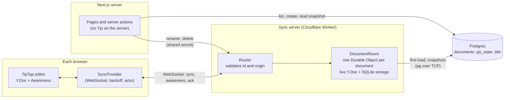
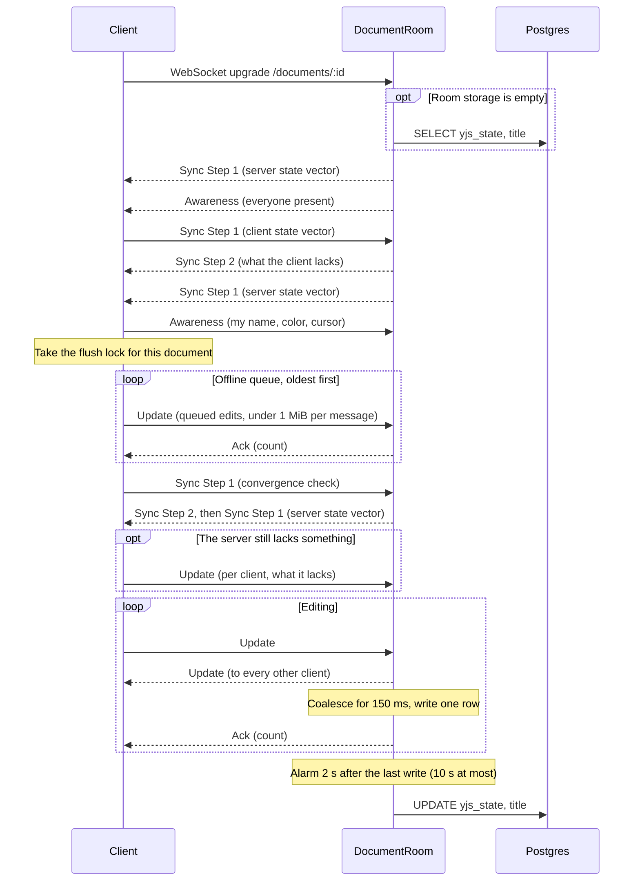

# Brahma

A collaborative document editor, built in phases. This repository is at **Phase 3**: several people edit the same document live, with presence, through a sync server built on Cloudflare Durable Objects, and Brahma keeps working without a network. Accounts and permissions are Phase 4.

## What it does

- **Documents.** Create, rename and delete documents (delete asks for confirmation). The sidebar lists them by last edit. Rename needs the sync server ("Couldn't rename. Try again." otherwise); delete works even when it is down (see [Delete](#delete)).
- **Editor.** A title plus rich text: headings 1 to 3, bold, italic, strikethrough, inline code, code blocks, bulleted, numbered and task lists, quotes, links and horizontal rules. Markdown shortcuts work (`## `, `- `, `[ ] `, `> `, ` ``` `, `**bold**`, and so on).
- **Floating toolbar.** Appears only when text is selected: block type menu, inline marks and a link field. `Cmd/Ctrl+K` adds a link, `Alt+F10` moves focus into the toolbar, `Esc` returns to the text.
- **Live collaboration.** Everyone with the link edits the same document at once. Concurrent edits merge without conflicts, including the title.
- **Presence.** Each person gets a caret and selection in one of six collaborator colors with a name flag, and an avatar in the top bar. There are no accounts yet: you set a display name from your avatar, kept in a cookie.
- **Undo is yours.** `Cmd/Ctrl+Z` undoes only your own edits, never a collaborator's, in the body and in the title.
- **Works offline.** Documents opened on this device open, and stay editable, without a network. Edits are written to the device first, survive closing the tab or a crash, and merge when the connection returns (see [Offline](#offline)).
- **One status.** The top bar shows connection, device and server state in a few words (see [Status](#status)). Leaving the page shows the browser's warning only if an edit is neither on the server nor written to the device.
- **Theme.** A manual light/dark toggle. Light is the default, the system setting is ignored, and the choice is kept in a cookie so the first paint is correct.
- **Responsive and accessible.** Below 768 px the sidebar becomes a drawer. Everything works from the keyboard, focus is always visible, and motion respects `prefers-reduced-motion`.

## Run it locally

Requirements: Node 20.9 or newer, pnpm, and Docker (or any Postgres 14+).

```sh
pnpm install
cp .env.example .env.local                                  # Next app
cp workers/sync/.dev.vars.example workers/sync/.dev.vars    # sync server
pnpm db:up                                                  # Postgres 17 with docker compose
pnpm db:migrate                                             # creates the documents table
pnpm dev:sync                                               # sync server on http://localhost:8787
pnpm dev                                                    # app on http://localhost:3000 (second terminal)
```

Open the same document in two browsers (or a normal and a private window) to see collaboration.

### Scripts

| Command | What it does |
| --- | --- |
| `pnpm dev` | Next development server |
| `pnpm dev:sync` | Sync server (`wrangler dev` in `workers/sync`) |
| `pnpm build` / `pnpm start` | Production build (also generates `public/sw.js`) and server. The service worker only registers in production builds. |
| `pnpm typecheck` | Route types and `tsc` for the app, Worker types and `tsc` for the sync server |
| `pnpm lint` | ESLint, plus a check that no file contains an em dash |
| `pnpm test` | Vitest unit tests (app and protocol package) |
| `pnpm test:sync` | Durable Object tests inside the Workers runtime |
| `pnpm test:e2e` | Playwright. Starts `wrangler dev` on port 8788 itself, then builds and starts the app on port 3100. Run `pnpm exec playwright install chromium` once first. |
| `pnpm check:bundles` | After `pnpm build`: fails if Yjs is in any server bundle or in more than one client chunk |
| `pnpm db:generate` / `pnpm db:migrate` | Create and apply migrations |

The end-to-end tests create documents in whatever database `DATABASE_URL` points at, so use the local container for them.

## Environment variables

Next app ([.env.example](.env.example)):

| Variable | Value |
| --- | --- |
| `DATABASE_URL` | Locally, the container URL. On Neon, the **pooled** connection string (host contains `-pooler`). |
| `DATABASE_URL_UNPOOLED` | Used by `drizzle-kit` only. On Neon, the **direct** connection string. |
| `NEXT_PUBLIC_SYNC_URL` | WebSocket base URL of the sync server, for example `ws://localhost:8787`. Read at build time. |
| `SYNC_INTERNAL_URL` | HTTP base URL of the sync server, for rename and delete from the sidebar. |
| `SYNC_INTERNAL_SECRET` | Shared secret for those calls. Must match the Worker's. |

Sync server ([workers/sync/.dev.vars.example](workers/sync/.dev.vars.example); Worker secrets in production):

| Variable | Value |
| --- | --- |
| `DATABASE_URL` | Postgres for loading and snapshotting documents. On Neon, the **pooled** string. |
| `SYNC_INTERNAL_SECRET` | Same value as the app's. |
| `ALLOWED_ORIGINS` | In `wrangler.jsonc`: browser origins allowed to open a socket. |

There is no deployment. Phase 2 still has no authentication, so it runs only locally and in CI.

## Architecture



- **The browser** keeps a `Y.Doc` for the body (a `Y.XmlFragment`) and the title (a `Y.Text`). The page renders the Postgres snapshot first, so content shows before the socket connects.
- **The Durable Object** is the only writer for its document. It holds the live document in memory and in its own SQLite storage, relays updates and presence, and copies snapshots to Postgres.
- **Postgres** holds a snapshot per document for the document list and for first loads. The list on a fresh page load can trail the latest edit by a few seconds (the snapshot delay); the sidebar in an open editor updates as soon as an edit is acknowledged. The Next server reads it and creates rows, but never writes content or titles; rename and delete go through the Durable Object.

## Why a CRDT instead of OT

Operational transformation (Google Docs, early Etherpad) sends operations to a central server, which transforms each one against concurrent operations and decides the order. It works, but correctness depends on transformation functions for every pair of operation types, the server must see every operation in order, and a client that was offline has to replay its edits through the server before they mean anything.

A CRDT (here, Yjs) gives every character a unique id and a position relative to its neighbours, so concurrent edits merge to the same result on every replica regardless of the order they arrive in. For Brahma that means:

- **The server is a relay and a store, not an arbiter.** It does not transform anything. It merges updates with `Y.applyUpdate`, which is commutative and idempotent, so a resent update is harmless.
- **Reconnects are a state exchange, not a replay.** After an outage each side sends its state vector and receives exactly what it lacks (the sync handshake below). Edits made while disconnected need no special handling. This is also the foundation for offline support in Phase 3.
- **The data model did not change.** Phase 1 already stored Yjs state, so Phase 1 documents load into a Durable Object as they are.
- **Per-user undo falls out of transaction origins.** Every change carries an origin; the undo manager tracks only local origins.

The costs: Yjs keeps tombstones for deleted content (garbage-collected where safe, and compacted on every snapshot), and the merged result of a true conflict, such as two people typing at the same spot, is deterministic but not always what either person intended. For prose that is the right trade.

## Sync protocol

Every WebSocket message is binary and starts with a varUint type. Framing follows y-websocket; the sync and awareness payloads are written and read with `y-protocols`. Everything lives in [packages/protocol](packages/protocol/src/messages.ts) so the client and server cannot disagree.

| Type | Name | Direction | Payload and meaning |
| --- | --- | --- | --- |
| `0` / `0` | Sync Step 1 | both | State vector: "this is what I have, send what I lack". |
| `0` / `1` | Sync Step 2 | both | Update: "everything you were missing". |
| `0` / `2` | Update | both | One incremental change. The server relays it to everyone else. |
| `1` | Awareness | both | Presence states (name, color, cursor). The server relays them and removes a client's states when its socket closes. |
| `3` | Query awareness | server to client | After waking from hibernation the server has no presence; it asks clients to resend. |
| `4` | Ack | server to client | Cumulative count of document messages (Step 2 and Update) from this connection that are now durable. Brahma-specific. |

An invalid document id or a disallowed browser origin is rejected with HTTP 400 or 403 before the upgrade, so no Durable Object is created. Close codes: `4404` document not found, `4410` document deleted, `1007` malformed message, `1009` message over 4 MiB. Only the offending socket closes; the room carries on.



### Status

One label, computed by a pure function ([src/lib/collab/status.ts](src/lib/collab/status.ts)). Rules are checked in order; the first that matches wins.

| # | Condition | Label |
| --- | --- | --- |
| 1 | The document was deleted or does not exist | The editor is replaced by a message |
| 2 | The server refused an edit even when sent alone | Banner: "This document couldn't sync. Your edits are kept on this device." |
| 3 | A local edit has waited more than 1 s to be written on the device (or cannot be: storage full) | Saving |
| 4 | The browser is offline | Saved on this device |
| 5 | Online, socket not synced, this tab has never synced | Connecting |
| 6 | Online, socket down, every local edit written on the device | Reconnecting. Saved on this device. |
| 7 | Online, socket down, a write to the device still in progress | Reconnecting |
| 8 | Connected, sending the offline queue or verifying convergence | Syncing |
| 9 | Connected, an ack is more than 1 s late | Saving |
| 10 | Connected and everything acknowledged | Saved |

Typical transitions: from Saved, the network drops and the label becomes Saved on this device; when it returns, Reconnecting. Saved on this device.; once the handshake is done with edits queued, Syncing; when the last queued edit is acknowledged and convergence is verified, Saved. A live edit whose ack is more than a second late goes from Saved to Saving and back. `navigator.onLine` can be true without internet, which is why rule 6 says the edits are safe while the label says Reconnecting. Reconnects use jittered exponential backoff from 0.5 s to 10 s.

## Snapshots and persistence

**Inside the Durable Object.** Incoming updates are applied to the live `Y.Doc` immediately and relayed, then coalesced: every 150 ms the pending updates are merged into one SQLite row and each socket gets one cumulative ack. Cloudflare's output gate holds those acks until the write is durable, so an ack is a promise. After 100 batches the update log is compacted into a single snapshot (split into chunks under the 2 MB row limit).

**Hibernation.** Rooms use the hibernatable WebSocket API: an idle room is evicted from memory while its sockets stay open, and costs nothing. The next message wakes a fresh instance, which rebuilds the `Y.Doc` from SQLite before handling it, and asks clients to resend presence. While people are connected, presence heartbeats wake the room about every 15 seconds.

**To Postgres.** A Durable Object alarm copies the compacted state and the title to the `documents` row:

- about 2 seconds after the last write, but no later than 10 seconds after the oldest edit not yet in Postgres;
- immediately when the last client disconnects;
- immediately after a rename from the sidebar, so the list is current.

The title in the column is cleaned the same way Phase 1 validated it. If the write fails, the alarm throws and the runtime retries it with backoff; the edits stay marked dirty. If the row is gone (deleted elsewhere), the room deletes itself. Because each room is the only writer of its row, no row lock or transaction is needed.

**Connecting to Neon from the Worker.** The Worker uses `pg` with the `nodejs_compat` flag. `pg` detects the Workers runtime and opens a raw TCP socket through `cloudflare:sockets`. Each load or snapshot opens a short connection, runs one statement and closes it, which suits the low rate (one snapshot every few seconds per active document). In production `DATABASE_URL` should be Neon's pooled string, so many rooms share few Postgres connections. Hyperdrive would cut connection latency and is a drop-in later.

<a id="delete"></a>**Delete.** Deleting happens in an order where any failure leaves a consistent state:

1. Write a tombstone (`deleted_at`) on the row. From that commit the document is deleted for the list, the page, the sync server and clients returning from offline.
2. Ask the Durable Object to close every socket with `4410` and erase itself (`deleteAlarm()`, `deleteAll()`). This is best effort: a room that loads a tombstoned row, a room that sees the tombstone on its first connection, and a snapshot that finds no live row all erase the room.

So delete works even while the sync server is down, and a document is never half deleted or unreachable. Tombstones are kept until accounts bring a purge policy, so a device returning from months offline still learns what happened.

**Durable Object limits.** On the Workers Free plan, SQLite-backed Durable Objects allow 100,000 rows written per day across the account, and every `setAlarm()` and delete counts as a row written ([pricing](https://developers.cloudflare.com/durable-objects/platform/pricing/), [limits](https://developers.cloudflare.com/durable-objects/platform/limits/)). Two choices keep Brahma inside that:

- **Batching.** One row per 150 ms window instead of one per keystroke, so continuous typing in one document writes at most about 7 update rows a second (roughly 24,000 an hour).
- **One alarm per snapshot, not per batch.** The first unsaved write sets the alarm 2 seconds out. When it fires, it checks the time of the last write in memory: if typing is still going on and the 10 second cap has not passed, it moves itself once; otherwise it snapshots. A naive debounce would call `setAlarm()` after every batch and double the writes.

Snapshots, compaction and the dirty marker add a handful of rows per alarm. That still means a few hours of continuous typing per day on the Free plan; a paid plan removes the daily cap.

## Offline

**Where data lives on the device.** Two places, both per browser profile and per origin:

- **IndexedDB, database `brahma`** ([src/lib/collab/local-store.ts](src/lib/collab/local-store.ts)): a compacted Yjs snapshot per document, the updates the server already has, the pending queue of local edits it has not acknowledged, and per-document metadata (title, synced on this device, pending count, halted). Edit writes use `durability: "strict"`, so a completed write survives a browser or operating system crash. Brahma uses its own store instead of y-indexeddb because the pending queue, per-write confirmation and metadata are the point, and one database avoids two sources of truth.
- **The service worker's caches** ([sw/sw.template.js](sw/sw.template.js)): the hashed app files, the pages of documents opened on this device, and an offline page.

**Load and sync order.** Opening a document applies, in order, what this device has (snapshot, acknowledged updates, pending edits), then the server snapshot embedded in the page (harmless if older), and renders. Then it connects: handshake, flush the pending queue (one tab per document, under a Web Lock), verify convergence by comparing state vectors, and only then send live edits. Each local edit is written to the device and, when connected, sent at once; the server's ack moves it from pending to acknowledged in one transaction. Tabs of the same document share edits through a `BroadcastChannel`, online or not.

**Large and rejected edits.** Queued edits go out oldest first, packed into messages under 1 MiB. Brahma's per-message cap is 4 MiB, an eighth of Cloudflare's 32 MiB ([Workers WebSockets](https://developers.cloudflare.com/workers/runtime-apis/websockets/)). A single change estimated over 1 MB (a huge paste) is refused before it is applied, because one Yjs update cannot be split. If the server rejects a message anyway, the next connection sends one edit per message and waits for each ack. An edit rejected on its own halts sync for that document: later edits depend on it, so nothing is ever skipped. Every edit stays on the device, and "Download a copy" saves the document as HTML.

**Conflicts.** There are none to resolve by hand. Edits made offline, by one person or several, merge through Yjs when they reach the server, and every replica converges to the same text. Two people typing at the same spot offline both keep their words; the order between them is deterministic but arbitrary.

**Delete semantics.** A device learns about a deletion when it reconnects (`4410`) or loads the page. If it holds edits the server never received, it shows "This document was deleted while you were offline." and offers **Save as new document**: an empty document is created and the local copy becomes its pending queue, so the normal flush uploads it. **Discard** clears the local copy. With no unsent edits, the local copy is simply cleared.

**What works offline.** Documents opened on this device (since the service worker was installed) open and edit normally; the sidebar dims the rest as "Not available offline". New documents need the network. Opening a document this device never had shows "This document isn't available offline." with the documents it does have.

**Storage limits.** Data is best-effort unless persistent: Brahma calls `navigator.storage.persist()` on the first local edit. Chromium browsers allow an origin up to 60% of the disk; Firefox's best-effort limit is the smaller of 10% of the disk or 10 GiB; Safari's limits depend on the app, and it may proactively evict data of sites that have not been used for a while ([MDN: storage quotas and eviction](https://developer.mozilla.org/en-US/docs/Web/API/Storage_API/Storage_quotas_and_eviction_criteria)). When a write fails for lack of space, Brahma says "This device is out of storage for Brahma. Your edits still sync while you're online." and keeps those edits in memory until the server acknowledges them, with the leave warning on.

**Shared computers (Phase 4).** Everything above stays on the device after the tab closes. When accounts arrive, signing out must delete the `brahma` IndexedDB database **and** the service worker's caches (they hold document pages), and clear the guest cookies, so the next person on the same computer sees nothing.

## Changing the document schema

Shared document content is untrusted: any editor can send raw Yjs data. So the editor binding removes shared content its schema cannot hold, and for editors that removal syncs. The same rule would let a tab running an older cached bundle remove content made with node types it does not know. Schema versions prevent that.

- The editor's schema has a version, `DOCUMENT_SCHEMA_VERSION` in [schema-version.ts](src/components/editor/schema-version.ts). The client sends it with every connection as a subprotocol entry: `brahma.v1, schema.<n>, auth.<token>`. It describes the client's code, not the user, so it is not a token claim: the app server issues tokens but cannot know which bundle a tab runs.
- The deployment decides which versions are valid: `SCHEMA_VERSION_MIN` and `SCHEMA_VERSION_MAX` in the Worker config ([wrangler.jsonc](workers/sync/wrangler.jsonc)). A claim above `MAX` is refused with close code `4427` and recorded nowhere, so no client can lock others out by claiming a huge version; the client halts with the couldn't-sync banner, since reloading would not help.
- Within those bounds, each document's room remembers the newest version it has seen, re-checked against the current config on every connect. It refuses an older client (or one below `MIN`) with close code `4426` before accepting the socket, so none of that client's updates are applied, and a newer client closes older ones still connected. If a rollback lowers `MAX`, a remembered value above it is clamped, so the rolled-back clients get back in.
- On `4426` the client stops syncing, waits until every queued edit is written to the device, updates the service worker and reloads, showing "Brahma was updated. Reloading." The queued edits stay on the device and the new bundle sends them. If a tab already reloaded for an update in the last two minutes, it asks the user to reload instead of reloading again, so it can never loop.

When you add a node type, mark type or attribute:

1. Only add. Never remove or rename a type or attribute that documents may contain, and never narrow what an existing node may contain. New clients would remove that content from every document they open.
2. Give new attributes defaults, so content from older clients stays valid.
3. Bump `DOCUMENT_SCHEMA_VERSION` in the same change and record the new fingerprint in [schema-version.test.ts](src/components/editor/schema-version.test.ts). That test fails until you do, and another fails if anything from an earlier version disappears.
4. Release in this order:
   1. Raise `SCHEMA_VERSION_MAX` to the new version and deploy the Worker. Nothing changes for current clients.
   2. Deploy the app. Once a client on the new version opens a document, older tabs on that document are refused and reload.
   3. Once old clients have updated, raise `SCHEMA_VERSION_MIN` and deploy the Worker again, so any tab still on an old bundle reloads before it can write.

   To roll back the app, lower `SCHEMA_VERSION_MAX` again: rooms clamp what they remember, and the rolled-back clients get back in.

The version protects honest clients running an old bundle. A client can claim any version, but a malicious editor could delete content anyway.

## Why Yjs never loads on the server

Turbopack bundles `node_modules` into each server entry (pages, route handlers, server-side rendering of client components), and all of them run in one Node process. Yjs sets a flag on `globalThis` when it loads and warns when a second copy appears ("Yjs was already imported"), because two copies break its `instanceof` checks. Phase 1 had four server copies. Now:

- Server code never imports Yjs: new documents use a two-byte empty-state constant, and merging happens in the Durable Object.
- The editor loads with `next/dynamic` and `ssr: false`, behind a skeleton that reserves its space so nothing shifts.
- Client collaboration modules import `client-only`, and an ESLint rule blocks Yjs, TipTap and collaboration imports in server files.
- `pnpm check:bundles` runs in CI after the build.

## Data model decisions

```
documents
  id           uuid primary key
  title        text, default ''   copy of the shared title, written by the sync server
  yjs_state    bytea              snapshot of the document's Yjs state, written by the sync server
  created_at   timestamptz
  updated_at   timestamptz        drives "sorted by last edit" (partial index on live rows)
  deleted_at   timestamptz        tombstone; set first when a document is deleted
```

**Why Yjs state was stored from day one.** Phase 1 already kept the body in a `Y.Doc` and stored its binary state, not HTML or ProseMirror JSON. Phase 2 changed the transport (HTTP saves became a WebSocket to a Durable Object) without converting a single document: a room loads the stored bytes as they are.

**Why the title is both shared and a column.** Inside the document it is a `Y.Text`, so it syncs live and merges like the body. The sidebar needs titles for every document without loading Yjs, so snapshots copy it into the column. A Phase 1 document's title exists only in the column; its room seeds the `Y.Text` from it on first load.

**Ownership and workspaces.** `owner_id` and `workspace_id` arrive with authentication in Phase 4 as nullable columns, an additive migration.

## Design system

The palette comes from natural dyes (indigo, madder, turmeric) on a cool paper, used sparingly so the writing stays the focus. Every color is a CSS variable in [src/app/globals.css](src/app/globals.css), exposed to Tailwind through `@theme`.

| Token | Light | Dark | Role |
| --- | --- | --- | --- |
| `paper` | `#F2F3F6` | `#12162B` | App and document canvas |
| `sunken` | `#E8EAF0` | `#0E1124` | Sidebar, code blocks |
| `raised` | `#FFFFFF` | `#1A1F38` | Menus, toolbar, dialogs |
| `ink` | `#1A1F3A` | `#E6E8F0` | Primary text |
| `ink-muted` | `#5C627A` | `#9CA2BE` | Secondary text |
| `slate` | `#6A7088` | `#7C82A0` | Icons and borders only |
| `indigo` | `#34449C` | `#9AA8F2` | Links, primary actions, focus |
| `madder` | `#B8423A` | `#E8817A` | Destructive actions and errors |
| `selection` | turmeric `#D99A1E` at 28% | at 30% | Text selection |

### Measured contrast (WCAG 2.x)

| Pair | Light | Dark |
| --- | --- | --- |
| `ink` on `paper` | 14.55 | 14.60 |
| `ink` on `raised` | n/a | 13.23 |
| `ink-muted` on `paper` | 5.43 | 7.08 |
| `ink-muted` on `sunken` | 5.01 | 7.40 |
| `indigo` on `paper` | 7.72 | 7.88 |
| `on-indigo` on `indigo` (buttons) | 8.56 | 7.88 |
| `madder` on `paper` | 4.88 | 6.68 |
| `on-madder` on `madder` (buttons) | 5.41 | 6.68 |
| `ink` on selection tint | 11.74 | 8.41 |

`slate` on paper is 4.42:1, which is why it is reserved for icons and borders (3:1 minimum) and never used for small text.

### Collaborator colors

Each one must work as a caret on the canvas (at least 3:1) and as a name label behind text (at least 4.5:1).

| Color | Light | Caret on paper | Label text | Dark | Caret on night | Label text (night `#12162B`) |
| --- | --- | --- | --- | --- | --- | --- |
| indigo | `#34449C` | 7.72 | white 8.56 | `#8E9CF0` | 6.95 | 6.95 |
| madder | `#B8423A` | 4.88 | white 5.41 | `#E2847B` | 6.65 | 6.65 |
| turmeric | `#B87D10` | 3.17 | ink 4.60 | `#E3A83F` | 8.46 | 8.46 |
| leaf | `#4E7D4A` | 4.34 | white 4.82 | `#82B57A` | 7.52 | 7.52 |
| lac | `#A8467A` | 4.95 | white 5.49 | `#D884B0` | 6.68 | 6.68 |
| kattha | `#7A4B2E` | 6.59 | white 7.31 | `#C99470` | 6.77 | 6.77 |

Light turmeric is `#B87D10` rather than `#C98A12`, because the original measured 2.66:1 as a caret on paper.

### Type

- **UI:** Schibsted Grotesk at 12, 13, 14 and 15 px. The chrome stays quiet.
- **Document:** Literata. Body text is 19/1.65 (17 px on phones) at a 68 character measure. The title is 42 px weight 650. Headings use the optical size axis: H1 30 px, H2 24 px, H3 19 px italic.
- **Code:** Commit Mono, bundled locally under the SIL Open Font License ([license](src/fonts/commit-mono/LICENSE.txt)).

Radius follows hierarchy: none on the canvas, 4 px on inline code, 6 px on inputs and buttons, 8 px on menus and the toolbar, 10 px on dialogs. Hairline borders separate surfaces. Shadows appear only on floating layers.

## Project layout

```
src/
  app/                 routes, server actions, global styles (no Yjs)
  components/          app shell, sidebar, menus, dialogs
  components/editor/   editor, floating toolbar, shared title, presence, sync status
  db/                  Drizzle schema and client
  lib/                 validation and helpers
  lib/collab/          client-only: SyncProvider, device store, status, tabs, presence (unit tested)
  server/              database access and the sync server's internal API
packages/protocol/     wire format, limits, presence rules shared by client and server
sw/                    service worker template (built into public/sw.js)
workers/sync/          Cloudflare Worker: router, DocumentRoom Durable Object, Postgres store
e2e/                   Playwright tests, including two-browser collaboration
drizzle/               SQL migrations
```
