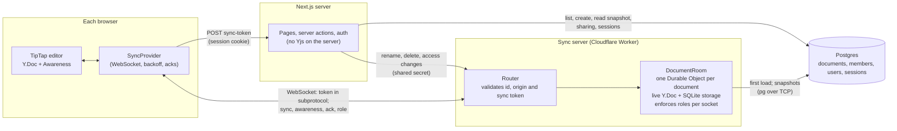
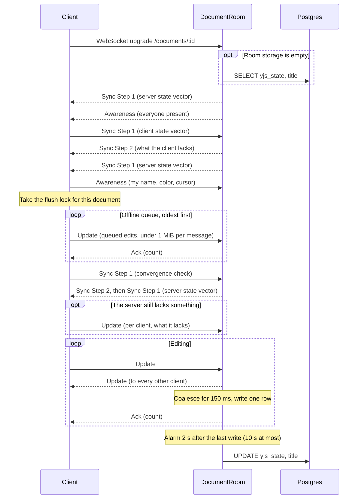
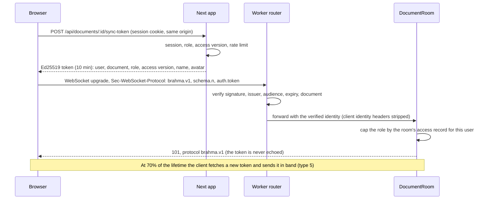

# Brahma

A collaborative document editor, built in phases. This repository is at **Phase 4**: people sign in, own documents and share them as editors or viewers; several people edit the same document live, with presence, through a sync server built on Cloudflare Durable Objects; and Brahma keeps working without a network. Permissions are enforced on the app server and again on the sync server (see [Auth and permissions](#auth-and-permissions)).

## What it does

- **Accounts.** Sign in with Google or an email link. Every document has one owner.
- **Sharing.** The owner invites people by email as editors or viewers, and can turn on a share link with a role ("Anyone with the link", sign-in required). Roles change and access ends live, even for people who have the document open. The sidebar has "My documents" and "Shared with me".
- **Documents.** Create, rename and delete documents (delete asks for confirmation; only the owner deletes). The sidebar lists them by last edit. Rename needs the sync server ("Couldn't rename. Try again." otherwise); delete works even when it is down (see [Delete](#delete)).
- **Editor.** A title plus rich text: headings 1 to 3, bold, italic, strikethrough, inline code, code blocks, bulleted, numbered and task lists, quotes, links and horizontal rules. Markdown shortcuts work (`## `, `- `, `[ ] `, `> `, ` ``` `, `**bold**`, and so on).
- **Floating toolbar.** Appears only when text is selected: block type menu, inline marks and a link field. `Cmd/Ctrl+K` adds a link, `Alt+F10` moves focus into the toolbar, `Esc` returns to the text.
- **Live collaboration.** Everyone with access edits the same document at once; viewers see every edit live but cannot type. Concurrent edits merge without conflicts, including the title.
- **Presence.** Each person gets a caret and selection in one of six collaborator colors with their account name, and an avatar in the top bar. One person with several tabs counts once.
- **Undo is yours.** `Cmd/Ctrl+Z` undoes only your own edits, never a collaborator's, in the body and in the title.
- **Works offline.** Documents opened on this device open, and stay editable, without a network. Edits are written to the device first, survive closing the tab or a crash, and merge when the connection returns (see [Offline](#offline)).
- **One status.** The top bar shows connection, device and server state in a few words (see [Status](#status)). Leaving the page shows the browser's warning only if an edit is neither on the server nor written to the device.
- **Theme.** A manual light/dark toggle. Light is the default, the system setting is ignored, and the choice is kept in a cookie so the first paint is correct.
- **Responsive and accessible.** Below 768 px the sidebar becomes a drawer. Everything works from the keyboard, focus is always visible, and motion respects `prefers-reduced-motion`.

## Run it locally

Requirements: Node 20.9 or newer, pnpm, and Docker (or any Postgres 14+).

```sh
pnpm install
cp .env.example .env.local                                  # Next app
cp workers/sync/.dev.vars.example workers/sync/.dev.vars    # sync server
pnpm db:up                                                  # Postgres 17 with docker compose
pnpm db:migrate                                             # creates the tables
pnpm keys:sync                                              # sync token keys, into both env files
pnpm dev:sync                                               # sync server on http://localhost:8787
pnpm dev                                                    # app on http://localhost:3000 (second terminal)
```

Sign in with an email address: with `EMAIL_TRANSPORT=console` (the default locally) the sign-in link is printed in the `pnpm dev` terminal. To see collaboration, sign in as two people in two browsers (or a normal and a private window) and share a document from the Share button. Documents created before accounts belong to a placeholder owner; `pnpm db:claim-local --email you@example.com` gives them to your account.

### Scripts

| Command | What it does |
| --- | --- |
| `pnpm dev` | Next development server |
| `pnpm dev:sync` | Sync server (`wrangler dev` in `workers/sync`) |
| `pnpm build` / `pnpm start` | Production build (also generates `public/sw.js`) and server. The service worker only registers in production builds. |
| `pnpm typecheck` | Route types and `tsc` for the app, Worker types and `tsc` for the sync server |
| `pnpm lint` | ESLint, plus a check that no file contains an em dash |
| `pnpm test` | Vitest unit tests (app and protocol package) |
| `pnpm test:integration` | Server actions, routes and authorization against Postgres, as every role |
| `pnpm test:sync` | Durable Object tests inside the Workers runtime |
| `pnpm test:e2e` | Playwright. Starts `wrangler dev` on port 8788 itself, then builds and starts the app on port 3100, and signs people in through real email links (a file outbox). Run `pnpm exec playwright install chromium` once first. Build with `NEXT_PUBLIC_E2E_HOOKS=1` (CI does) for the test that plays an outdated bundle. |
| `pnpm check:bundles` | After `pnpm build`: fails if Yjs is in any server bundle or in more than one client chunk |
| `pnpm db:generate` / `pnpm db:migrate` | Create and apply migrations |
| `pnpm keys:sync` | Generate the Ed25519 key pair for sync tokens and write it to `.env.local` and `workers/sync/.dev.vars` |
| `pnpm db:claim-local --email <address>` | Give documents created before accounts to that account |

The end-to-end tests create documents in whatever database `DATABASE_URL` points at, so use the local container for them.

## Environment variables

Next app ([.env.example](.env.example)):

| Variable | Value |
| --- | --- |
| `DATABASE_URL` | Locally, the container URL. On Neon, the **pooled** connection string (host contains `-pooler`). |
| `DATABASE_URL_UNPOOLED` | Used by `drizzle-kit` only. On Neon, the **direct** connection string. |
| `NEXT_PUBLIC_SYNC_URL` | WebSocket base URL of the sync server, for example `ws://localhost:8787`. Read at build time. |
| `SYNC_INTERNAL_URL` | HTTP base URL of the sync server, for rename, delete and access changes. |
| `SYNC_INTERNAL_SECRET` | Shared secret for those calls. Must match the Worker's. |
| `BETTER_AUTH_SECRET` | 32 or more random bytes; signs sessions and share links. |
| `BETTER_AUTH_URL` | The app's public URL. Auth cookies, redirects and allowed origins follow it. |
| `GOOGLE_CLIENT_ID`, `GOOGLE_CLIENT_SECRET` | Optional locally. Redirect URI: `<BETTER_AUTH_URL>/api/auth/callback/google`. |
| `EMAIL_TRANSPORT` | `resend` in production; `console` (print links) or `file` (test outbox) only on localhost. |
| `RESEND_API_KEY`, `EMAIL_FROM` | For `resend`. |
| `SYNC_TOKEN_PRIVATE_KEY` | Ed25519 private key (JWK with `kid`) that signs sync tokens. `pnpm keys:sync` creates it. |
| `AUTH_CLIENT_IP_HEADER`, `AUTH_TRUSTED_PROXIES` | Only behind a proxy that overwrites the header with the real address. See [Rate limits](#rate-limits). |
| `MAGIC_LINK_DAILY_LIMIT` | Sign-in links per day, site wide. Default 80, under Resend's free plan. |

Sync server ([workers/sync/.dev.vars.example](workers/sync/.dev.vars.example); Worker secrets in production):

| Variable | Value |
| --- | --- |
| `DATABASE_URL` | Postgres for loading and snapshotting documents. On Neon, the **pooled** string. |
| `SYNC_INTERNAL_SECRET` | Same value as the app's. |
| `SYNC_TOKEN_PUBLIC_KEYS` | JWKS with the public key(s) that verify sync tokens. Several keys allow rotation. |
| `ALLOWED_ORIGINS` | In `wrangler.jsonc`: browser origins allowed to open a socket. |
| `SCHEMA_VERSION_MIN`, `SCHEMA_VERSION_MAX` | In `wrangler.jsonc`: document schema versions this deployment accepts (see [Changing the document schema](#changing-the-document-schema)). |

Production values, and where each one is set, are in [Deploying](#deploying).

## Architecture



- **The browser** keeps a `Y.Doc` for the body (a `Y.XmlFragment`) and the title (a `Y.Text`). The page renders the Postgres snapshot first, so content shows before the socket connects.
- **The Durable Object** is the only writer for its document. It holds the live document in memory and in its own SQLite storage, relays updates and presence, and copies snapshots to Postgres.
- **Postgres** holds a snapshot per document for the document list and for first loads. The list on a fresh page load can trail the latest edit by a few seconds (the snapshot delay); the sidebar in an open editor updates as soon as an edit is acknowledged. The Next server reads it and creates rows, but never writes content or titles; rename and delete go through the Durable Object.

## Why a CRDT instead of OT

Operational transformation (Google Docs, early Etherpad) sends operations to a central server, which transforms each one against concurrent operations and decides the order. It works, but correctness depends on transformation functions for every pair of operation types, the server must see every operation in order, and a client that was offline has to replay its edits through the server before they mean anything.

A CRDT (here, Yjs) gives every character a unique id and a position relative to its neighbours, so concurrent edits merge to the same result on every replica regardless of the order they arrive in. For Brahma that means:

- **The server is a relay and a store, not an arbiter.** It does not transform anything. It merges updates with `Y.applyUpdate`, which is commutative and idempotent, so a resent update is harmless.
- **Reconnects are a state exchange, not a replay.** After an outage each side sends its state vector and receives exactly what it lacks (the sync handshake below). Edits made while disconnected need no special handling. This is also the foundation for offline support in Phase 3.
- **The data model did not change.** Phase 1 already stored Yjs state, so Phase 1 documents load into a Durable Object as they are.
- **Per-user undo falls out of transaction origins.** Every change carries an origin; the undo manager tracks only local origins.

The costs: Yjs keeps tombstones for deleted content (garbage-collected where safe, and compacted on every snapshot), and the merged result of a true conflict, such as two people typing at the same spot, is deterministic but not always what either person intended. For prose that is the right trade.

## Sync protocol

Every WebSocket message is binary and starts with a varUint type. Framing follows y-websocket; the sync and awareness payloads are written and read with `y-protocols`. Everything lives in [packages/protocol](packages/protocol/src/messages.ts) so the client and server cannot disagree.

| Type | Name | Direction | Payload and meaning |
| --- | --- | --- | --- |
| `0` / `0` | Sync Step 1 | both | State vector: "this is what I have, send what I lack". |
| `0` / `1` | Sync Step 2 | both | Update: "everything you were missing". |
| `0` / `2` | Update | both | One incremental change. The server relays it to everyone else. |
| `1` | Awareness | both | Presence states (name, color, cursor). The server relays them and removes a client's states when its socket closes. |
| `3` | Query awareness | server to client | After waking from hibernation the server has no presence; it asks clients to resend. |
| `4` | Ack | server to client | Cumulative count of document messages (Step 2 and Update) from this connection that are now durable. Brahma-specific. |
| `5` | Auth | client to server | A fresh sync token for the same user and document, sent before the current one expires. Brahma-specific. |
| `6` | Role | server to client | The user's role on this document changed (or a stale token was capped). Brahma-specific. |

The upgrade carries `Sec-WebSocket-Protocol: brahma.v1, schema.<n>, auth.<token>`; the server selects only `brahma.v1`, so the token is never echoed. An invalid document id, a disallowed browser origin, or a missing or invalid token is rejected with HTTP 400, 403 or 401 before the upgrade, so no Durable Object is created.

Close codes, and what the client does with each ([close-policy.ts](src/lib/collab/close-policy.ts), one table, unit tested per code):

| Code | Meaning | Client |
| --- | --- | --- |
| `4401` | Token expired or invalid | Fetches a new token and reconnects once; a second `4401` before syncing shows "session ended" |
| `4403` | Access removed | Stops; "You no longer have access to this document." |
| `4405` | A viewer sent a write | Downgrade handling, rebuilds the local copy as a viewer, reconnects; a viewer that gets `4405` halts |
| `4404`, `4400` | Not found, invalid id | Stops; not found |
| `4410` | Deleted | Stops; deleted handling |
| `4426` | Bundle older than the document's schema | Updates and reloads ("Brahma was updated. Reloading.") |
| `4427` | Bundle newer than the deployment accepts | Halts |
| `1007`, `1009` | Malformed, or over 4 MiB | One retry sending queued edits one per message, then halts |
| `1008` | Presence that does not match the signed-in user, or a client id another user's socket owns | Halts |
| other `4xxx` | Unknown application code | Halts |
| anything else | Network, restart | Reconnects with backoff |

Only the offending socket closes; the room carries on.

**A halt is never permanent.** The halted banner offers "Download a copy" and "Try again". Try again reconnects; once a sync gets every queued edit to the server, the halted flag stored on the device is cleared. If the server refuses again, the document halts again, with the edits still on the device. Signing out while halted warns first, since those edits would be deleted.

**Connections that vanish without a close frame.** Airplane mode, or a mobile network that drops, leaves the room holding the old socket, with no close frame to say it is gone. When the same tab reconnects, it announces the same presence client id. If the socket that owns that id belongs to the same user, the room treats it as stale: it hands the id to the new socket, closes the old one with `1000`, and logs `socket_replaced`. Another user claiming the id is still refused with `1008`. Before this, the reconnect was refused with `1008` and the document halted, which Playwright's `setOffline` never showed because it closes sockets cleanly; [e2e/silent-drop.spec.ts](e2e/silent-drop.spec.ts) drops only the page's side of the socket instead.



### Status

One label, computed by a pure function ([src/lib/collab/status.ts](src/lib/collab/status.ts)). Rules are checked in order; the first that matches wins.

| # | Condition | Label |
| --- | --- | --- |
| 1 | The document was deleted or does not exist | The editor is replaced by a message |
| 2 | The server refused an edit even when sent alone | Banner: "This document couldn't sync. Your edits are kept on this device." |
| 3 | A local edit has waited more than 1 s to be written on the device (or cannot be: storage full) | Saving |
| 4 | The browser is offline | Saved on this device |
| 5 | Online, socket not synced, this tab has never synced | Connecting |
| 6 | Online, socket down, every local edit written on the device | Reconnecting. Saved on this device. |
| 7 | Online, socket down, a write to the device still in progress | Reconnecting |
| 8 | Connected, sending the offline queue or verifying convergence | Syncing |
| 9 | Connected, an ack is more than 1 s late | Saving |
| 10 | Connected and everything acknowledged | Saved |

Typical transitions: from Saved, the network drops and the label becomes Saved on this device; when it returns, Reconnecting. Saved on this device.; once the handshake is done with edits queued, Syncing; when the last queued edit is acknowledged and convergence is verified, Saved. A live edit whose ack is more than a second late goes from Saved to Saving and back. `navigator.onLine` can be true without internet, which is why rule 6 says the edits are safe while the label says Reconnecting. Reconnects use jittered exponential backoff from 0.5 s to 10 s.

## Snapshots and persistence

**Inside the Durable Object.** Incoming updates are applied to the live `Y.Doc` immediately and relayed, then coalesced: every 150 ms the pending updates are merged into one SQLite row and each socket gets one cumulative ack. Cloudflare's output gate holds those acks until the write is durable, so an ack is a promise. After 100 batches the update log is compacted into a single snapshot (split into chunks under the 2 MB row limit).

**Hibernation.** Rooms use the hibernatable WebSocket API: an idle room is evicted from memory while its sockets stay open, and costs nothing. The next message wakes a fresh instance, which rebuilds the `Y.Doc` from SQLite before handling it, and asks clients to resend presence. While people are connected, presence heartbeats wake the room about every 15 seconds.

**To Postgres.** A Durable Object alarm copies the compacted state and the title to the `documents` row:

- about 2 seconds after the last write, but no later than 10 seconds after the oldest edit not yet in Postgres;
- immediately when the last client disconnects;
- before a rename from the sidebar answers, so a reload right after it lists the new title.

The title in the column is cleaned the same way Phase 1 validated it. If the write fails, the alarm throws and the runtime retries it with backoff; the edits stay marked dirty. If the row is gone (deleted elsewhere), the room deletes itself. Because each room is the only writer of its row, no row lock or transaction is needed.

**Connecting to Neon from the Worker.** The Worker uses `pg` with the `nodejs_compat` flag. `pg` detects the Workers runtime and opens a raw TCP socket through `cloudflare:sockets`. Each load or snapshot opens a short connection, runs one statement and closes it, which suits the low rate (one snapshot every few seconds per active document). In production `DATABASE_URL` should be Neon's pooled string, so many rooms share few Postgres connections. Hyperdrive would cut connection latency and is a drop-in later.

<a id="delete"></a>**Delete.** Deleting happens in an order where any failure leaves a consistent state:

1. Write a tombstone (`deleted_at`) on the row and, in the same statement, erase its content (`title` becomes empty and `yjs_state` the empty document). From that commit the document is deleted for the list, the page, the sync server and clients returning from offline, and its text is gone from the database. The sync server only writes rows with no tombstone, so nothing writes the content back (an integration test runs its Postgres store against a deleted row).
2. Ask the Durable Object to close every socket with `4410` and erase itself (`deleteAlarm()`, `deleteAll()`). This is best effort: a room that loads a tombstoned row, a room that sees the tombstone on its first connection, and a snapshot that finds no live row all erase the room.

So delete works even while the sync server is down, and a document is never half deleted or unreachable. The tombstoned row is kept, with only its id, owner, timestamps and `deleted_at`, so a device returning from months offline still learns what happened. The content survives only in database backups (see Backups and rollback).

**Durable Object limits.** On the Workers Free plan, SQLite-backed Durable Objects allow 100,000 rows written per day across the account, and every `setAlarm()` and delete counts as a row written ([pricing](https://developers.cloudflare.com/durable-objects/platform/pricing/), [limits](https://developers.cloudflare.com/durable-objects/platform/limits/)). Two choices keep Brahma inside that:

- **Batching.** One row per 150 ms window instead of one per keystroke, so continuous typing in one document writes at most about 7 update rows a second (roughly 24,000 an hour).
- **One alarm per snapshot, not per batch.** The first unsaved write sets the alarm 2 seconds out. When it fires, it checks the time of the last write in memory: if typing is still going on and the 10 second cap has not passed, it moves itself once; otherwise it snapshots. A naive debounce would call `setAlarm()` after every batch and double the writes.

Snapshots, compaction and the dirty marker add a handful of rows per alarm. That still means a few hours of continuous typing per day on the Free plan; a paid plan removes the daily cap.

## Offline

**Where data lives on the device.** Two places, both per browser profile and per origin:

- **IndexedDB, one database per user, `brahma:<userId>`** ([src/lib/collab/local-store.ts](src/lib/collab/local-store.ts)): a compacted Yjs snapshot per document, the updates the server already has, the pending queue of local edits it has not acknowledged, and per-document metadata (title, synced on this device, pending count, halted). Edit writes use `durability: "strict"`, so a completed write survives a browser or operating system crash. Brahma uses its own store instead of y-indexeddb because the pending queue, per-write confirmation and metadata are the point, and one database avoids two sources of truth.
- **The service worker's caches** ([sw/sw.template.js](sw/sw.template.js)): the hashed app files, and per user (`brahma-pages:<userId>`) the pages of documents opened on this device and an offline page. Pages carry the user's name and document list, so they are never shared between users. See [Service worker updates](#service-worker-updates) for what a deploy does to them.

**Load and sync order.** Opening a document applies, in order, what this device has (snapshot, acknowledged updates, pending edits), then the server snapshot embedded in the page (harmless if older), and renders. Then it connects: handshake, flush the pending queue (one tab per document, under a Web Lock), verify convergence by comparing state vectors, and only then send live edits. Each local edit is written to the device and, when connected, sent at once; the server's ack moves it from pending to acknowledged in one transaction. Tabs of the same document share edits through a `BroadcastChannel`, online or not.

**Large and rejected edits.** Queued edits go out oldest first, packed into messages under 1 MiB. Brahma's per-message cap is 4 MiB, an eighth of Cloudflare's 32 MiB ([Workers WebSockets](https://developers.cloudflare.com/workers/runtime-apis/websockets/)). A single change estimated over 1 MB (a huge paste) is refused before it is applied, because one Yjs update cannot be split. If the server rejects a message anyway, the next connection sends one edit per message and waits for each ack. An edit rejected on its own halts sync for that document: later edits depend on it, so nothing is ever skipped. Every edit stays on the device, and "Download a copy" saves the document as HTML.

**Conflicts.** There are none to resolve by hand. Edits made offline, by one person or several, merge through Yjs when they reach the server, and every replica converges to the same text. Two people typing at the same spot offline both keep their words; the order between them is deterministic but arbitrary.

**Delete semantics.** A device learns about a deletion when it reconnects (`4410`) or loads the page. If it holds edits the server never received, it shows "This document was deleted while you were offline." and offers **Save as new document**: an empty document is created and the local copy becomes its pending queue, so the normal flush uploads it. **Discard** clears the local copy. With no unsent edits, the local copy is simply cleared.

**What works offline.** Documents opened on this device (since the service worker was installed) open and edit normally; the sidebar dims the rest as "Not available offline". New documents need the network. Opening a document this device never had shows "This document isn't available offline." with the documents it does have.

**Storage limits.** Data is best-effort unless persistent: Brahma calls `navigator.storage.persist()` on the first local edit. Chromium browsers allow an origin up to 60% of the disk; Firefox's best-effort limit is the smaller of 10% of the disk or 10 GiB; Safari's limits depend on the app, and it may proactively evict data of sites that have not been used for a while ([MDN: storage quotas and eviction](https://developer.mozilla.org/en-US/docs/Web/API/Storage_API/Storage_quotas_and_eviction_criteria)). When a write fails for lack of space, Brahma says "This device is out of storage for Brahma. Your edits still sync while you're online." and keeps those edits in memory until the server acknowledges them, with the leave warning on.

**Shared computers.** Everything above stays on the device after the tab closes, per user. Signing out deletes it, and the next person to sign in on the device deletes anyone else's (see [Data on the device](#data-on-the-device)).

## Auth and permissions

### Accounts

[Better Auth](src/server/auth.ts) handles sign-in with Google and with email links (Resend in production; a link works once and expires in 10 minutes). Sessions last 30 days, in an HttpOnly, SameSite=Lax cookie that is Secure whenever the app's URL is https. Every page except sign-in requires a session ([proxy](src/proxy.ts), then a check in the layout). On the first sign-in with a verified email, pending invites for that address become memberships. Emails are trimmed and lowercased wherever they are compared.

### Roles

| | Owner | Editor | Viewer |
| --- | --- | --- | --- |
| Open, read, see live edits and presence | yes | yes | yes |
| Edit the body | yes | yes | no |
| Rename (title) | yes | yes | no |
| Delete | yes | no | no |
| Invite, manage the share link, change or remove access | yes | no | no |

One pure function holds this table ([permissions.ts](src/lib/permissions.ts)); the server uses it for every action and route, the interface uses it to hide what you cannot do, and the sync server enforces the editing rows again.

**Sharing.** An invite to an existing account adds them at once; any other address gets a pending invite. A share link carries an HMAC of the document id and a link version under a key derived from `BETTER_AUTH_SECRET`, so the owner can copy it any time without it being stored, and turning the link off and on again issues a new one. Opening a link requires signing in and grants the link's role, but never lowers a role someone already has. An explicit invite turns a link membership into an invite membership, so turning the link off removes only the people who joined through it. If an invite email cannot be sent, the invite still stands and the share dialog says so, with the document link to send by hand.

### Sync tokens



The token travels in the subprotocol header, so it stays out of URLs and logs. The room keeps the user, role, name, avatar and expiry in each socket's attachment, which survives hibernation. A socket whose token has expired (plus 60 s grace) is closed with `4401` on its next message; the client fetches a new token and reconnects. If the session itself has ended, the token request answers 401 and the editor says "You were signed out, so this document stopped syncing. Your edits are kept on this device." with a Sign in button.

**Live access changes.** Every change to someone's access (invite, role change, removal, link turned off) increments their access version in Postgres. After the response, the app posts the change to `POST /internal/documents/:id/access` (Next `after()`, three attempts, network errors, 429 and 5xx retried). The room records the newest version per user, sends a role message to that user's open sockets or closes them with `4403`, and from then on caps or refuses any token with an older version. Versions, not clocks, decide what is stale, so the app's and the room's clocks never need to agree. Two changes delivered out of order end in the newer one. If every attempt fails, an open socket keeps its old role until its next token refresh (at 70% of the lifetime) or until the token expires: **at most one token lifetime plus the grace period, about 11 minutes**.

### Where each permission is enforced

| Check | Where |
| --- | --- |
| Signed in | Proxy (cookie present), then every page, action and route (session) |
| Can open, rename, delete, share | Every server action and route, through one guard ([guards.ts](src/server/guards.ts)); no access answers the same as a missing document |
| Can receive a sync token, and with which role | The token route |
| Token valid for this document | The Worker router, before any Durable Object exists |
| Role on each socket, live | The DocumentRoom: viewers' writes are dropped and the socket closes with `4405` |
| Presence is yours | The DocumentRoom: each presence entry must carry the socket's user id and a client id no other user's socket owns (else `1008`; the same user's older socket is retired as stale); name and avatar are replaced with the token's |
| Read-only interface | The editor refuses typing, paste, drop, undo and the floating toolbar for viewers, and a viewer's editor works on a one-way copy of the document, so nothing it does can write. This is convenience; the room is the enforcement. |
| Internal endpoints | Shared secret, compared in constant time |

Integration tests call every action and route as owner, editor, viewer, a stranger and signed out; Playwright replays a real rename and delete request against a document the user cannot access.

### Offline edits when access changes

- **Removed while offline.** When the device reconnects, the token request finds no access. Queued edits are never sent. The editor is replaced by "You no longer have access to this document." with **Download a copy** (an HTML file of what this device had, queued edits included), and the local copy is deleted.
- **Made a viewer while offline.** The edits made while offline cannot be accepted. The editor shows "You can now only view this document. Edits you made offline weren't synced. Download a copy to keep them.", keeps that copy for download, deletes the local copy, opens the document again from the server, read-only.
- **Online.** The same happens immediately, through the role message or `4403`. Another tab of the same user learns about it over a `BroadcastChannel`: less access applies at once, more access is confirmed with the server first. A deletion is passed on the same way, so every open tab shows the same screen even if its own connection missed the server's message. A tab whose local copy is closed (discarded, or replaced by a viewer session) never accepts typing, so no edit can live only in memory and be lost.

<a id="data-on-the-device"></a>
### Data on the device

Each user has their own IndexedDB database and their own page caches, so one person's documents and offline edits are never visible to another.

- **Sign-out** ends the session, deletes the user's database and page caches, and sends their other tabs to sign-in. If the device holds edits that never synced, it asks first, since they would be lost. If the server cannot be reached, the dialog offers **Remove my data from this device**: the data is deleted at once, the page shows only "Your data was removed from this device. You'll be signed out when this device is back online, or when your session expires.", and the sign-out finishes when the device is back online.
- **Signing in cleans up after anyone else.** Sign-out does not always run (a session expires, a tab closes while offline), so every signed-in page load deletes other users' databases and page caches, the Phase 3 `brahma` database and the old guest cookies, and reloads tabs still showing someone else.
- **That cleanup runs only after the server confirms the signed-in user**, so it never runs offline. A page can show a user who is no longer signed in: a page served from the offline cache, or a tab left open from before someone else signed in. Cleaning up for that user would delete the signed-in person's data, so the page first asks the server who is signed in, and does nothing unless it is the page's user.
- **Pruning.** On a confirmed load, local copies of documents the user can no longer open are deleted, unless they hold edits that never synced (opening those shows the removed or deleted handling above).
- **A removed copy stays removed.** When access is removed, a document is deleted, or the user signs out, the page first stops the open document's writes to the device (a pending title save, batched updates from the server, compaction), then deletes the copy. The device store also refuses every write to a document whose record is gone; only opening a document creates its record. So a write that arrives later, from a timer, a late reply or another tab, cannot bring back a document, its title or its content. Edits refused this way stay in that tab's memory.

### CSRF

- **Server actions.** Next compares the `Origin` of every server action request with the host and refuses a mismatch; actions are POST only.
- **Auth endpoints.** Better Auth refuses requests that carry cookies, and redirect targets, from origins other than `BETTER_AUTH_URL`. Better Auth skips this check when `NODE_ENV` is `test` unless it is set, so [auth.ts](src/server/auth.ts) sets `disableOriginCheck: false` and the integration tests check the real behavior.
- **The token route.** Requires `Sec-Fetch-Site: same-origin` or an `Origin` equal to the app's.
- **The sync socket.** The Worker accepts browser connections only from `ALLOWED_ORIGINS`, and needs a token that only a same-origin request can obtain.
- **Cookies.** SameSite=Lax, so other sites' subresource requests and form posts carry no session.

<a id="rate-limits"></a>
### Rate limits

| What | Limit | Keyed by |
| --- | --- | --- |
| Sign-in links | 5 per hour | email address |
| Sign-in links | 80 per day (`MAGIC_LINK_DAILY_LIMIT`) | the whole site, under Resend's free plan (100 emails a day) |
| Auth endpoints | 100 per minute per path, stricter on sign-in paths (Better Auth) | client address, only when a trusted header is configured |
| Invites | 30 per hour | inviting user |
| Sync tokens | 600 per hour | user and document, so many tabs and reconnects never lock anyone out |

A client can send any `X-Forwarded-For`, and `next start` keeps it, so no client address header is trusted unless `AUTH_CLIENT_IP_HEADER` names one that a proxy in front of the app overwrites (Vercel: `x-forwarded-for`, Cloudflare: `cf-connecting-ip`; `AUTH_TRUSTED_PROXIES` for proxies that append). Without it, the per-address limits are off and the per-email and site-wide limits apply. If Resend refuses a send for quota reasons, sign-in says "Too many attempts. Try again in a few minutes." and the refusal is logged.

### Document content is untrusted

Any editor can send raw Yjs data that never went through the editor. Links may only point to http, https or mailto, wherever they are rendered, in the editor and in "Download a copy", whose HTML escapes all text and attributes. Content the schema cannot hold (an unknown node or mark) is removed by editors' clients and editing goes on; a viewer's editor works on a one-way copy, so nothing it removes is ever written. Tests send such content from a raw client and check that nothing runs or breaks in other people's browsers.

### Privacy policy

[/privacy](src/app/(public)/privacy/page.tsx) states, in plain language, what the app stores, where, who else handles it, the cookies, and how to have data deleted. Google requires its URL to publish the OAuth app. It is public: the request proxy lets it through without a session ([proxy.ts](src/proxy.ts)), and the service worker never keeps it in a user's page cache (`PUBLIC_PAGES` in [sw/cache-policy.mjs](sw/cache-policy.mjs)). A Playwright test checks both.

It must match the code. Update the page, and its "Last updated" date, when any of these change: the user, session, account, document, invite or share link tables; the providers (Neon, Vercel, Cloudflare, Resend, Sentry, Google) or their regions; the session length; the cookies or browser storage; the backup policy; what the Sentry scrubber removes. Contact goes through GitHub issues, never a personal email address.

### Security headers

Every response carries a Content Security Policy with `frame-ancestors 'none'`, `base-uri 'self'`, `form-action 'self'` and `object-src 'none'`; `X-Frame-Options: DENY`; `Referrer-Policy: same-origin` (document and share-link URLs carry ids and tokens); `X-Content-Type-Options: nosniff`; `Cross-Origin-Opener-Policy: same-origin`; a Permissions-Policy that turns off camera, microphone, location and payments; and HSTS when the app's URL is https.

<a id="threat-model"></a>
### Threat model

**Protected against:**

- **Reading or editing without access.** Every action, route, page and socket checks access; a stranger gets the same answer as for a missing document. Viewers cannot write, whatever their client sends.
- **Keeping access after it was removed.** Live changes reach open sockets at once; if that delivery fails, at most one token lifetime plus grace (about 11 minutes). Stale tokens are capped by access versions.
- **Forged or replayed tokens.** Ed25519 signatures with a pinned algorithm, issuer, audience, document and expiry; the router rejects anything else before a room exists. The token is never echoed and never in a URL.
- **Impersonation in presence.** Presence must carry the socket's user id and its own client ids; names and avatars come from the token.
- **CSRF and clickjacking.** See [CSRF](#csrf); the app cannot be framed.
- **Sign-in abuse.** Per-email and site-wide link limits that no header can dodge; per-address limits behind a trusted proxy only. The site-wide cap counts email sign-in only, so Google sign-in keeps working when it is reached.
- **Hostile document content.** Unsafe link schemes, event handler attributes and unknown node types from a raw client neither run nor break other people's editors or the downloaded copy.
- **The next person on a shared device.** Per-user storage, deleted on sign-out, and deleted for anyone else on the next confirmed sign-in, also when sign-out never ran. Cleanup runs only for a user the server confirms, so a stale or cached page cannot delete the signed-in person's data.
- **Stale or rolled-back bundles removing newer content.** Schema versions, bounded by the deployment (see below).
- **Leaking internal endpoints.** Shared secret, compared in constant time.

**Not protected against, or accepted:**

- **A malicious editor.** Editors can change or delete content, as intended. Version history to undo vandalism is not built.
- **Unsynced edits of the previous user.** When someone else signs in on a device, the previous user's edits that never synced are deleted without asking, because keeping one person's data away from the next comes first. The previous user is asked only when they sign out themselves.
- **Sign-out while offline** ends the session on the server only when the device is back online, or when the session expires. "Remove my data from this device" deletes the data at once.
- **A delivery failure for access changes** leaves up to about 11 minutes of old access on already open sockets (above).
- **Without a trusted proxy header,** the site-wide link cap is shared by everyone: a flood of sign-in requests can use it up and block email sign-in (not Google) for up to a day. Configure `AUTH_CLIENT_IP_HEADER` in production.
- **Script injection defenses beyond output encoding.** There is no `script-src` policy yet: Next's inline scripts need per-request nonces, which also changes how pages are cached for offline use.
- **Share links** can be opened from any site's link: the link is the capability, and sign-in is required. Turning it off revokes it.
- **A compromised device, browser extension or email account,** and anyone with access to the servers or the database. Documents are not end-to-end encrypted; the app server and the sync server can read them.
- **Denial of service** against the app or the sync server beyond the rate limits above.

## Changing the document schema

Shared document content is untrusted: any editor can send raw Yjs data. So the editor binding removes shared content its schema cannot hold, and for editors that removal syncs. The same rule would let a tab running an older cached bundle remove content made with node types it does not know. Schema versions prevent that.

- The editor's schema has a version, `DOCUMENT_SCHEMA_VERSION` in [schema-version.ts](src/components/editor/schema-version.ts). The client sends it with every connection as a subprotocol entry: `brahma.v1, schema.<n>, auth.<token>`. It describes the client's code, not the user, so it is not a token claim: the app server issues tokens but cannot know which bundle a tab runs.
- The deployment decides which versions are valid: `SCHEMA_VERSION_MIN` and `SCHEMA_VERSION_MAX` in the Worker config ([wrangler.jsonc](workers/sync/wrangler.jsonc)). A claim above `MAX` is refused with close code `4427` and recorded nowhere, so no client can lock others out by claiming a huge version; the client halts with the couldn't-sync banner, since reloading would not help.
- Within those bounds, each document's room remembers the newest version it has seen, re-checked against the current config on every connect. It refuses an older client (or one below `MIN`) with close code `4426` before accepting the socket, so none of that client's updates are applied, and a newer client closes older ones still connected. If a rollback lowers `MAX`, a remembered value above it is clamped, so the rolled-back clients get back in.
- On `4426` the client stops syncing, waits until every queued edit is written to the device, updates the service worker and reloads, showing "Brahma was updated. Reloading." The queued edits stay on the device and the new bundle sends them. If a tab already reloaded for an update in the last two minutes, it asks the user to reload instead of reloading again, so it can never loop.

When you add a node type, mark type or attribute:

1. Only add. Never remove or rename a type or attribute that documents may contain, and never narrow what an existing node may contain. New clients would remove that content from every document they open.
2. Give new attributes defaults, so content from older clients stays valid.
3. Bump `DOCUMENT_SCHEMA_VERSION` in the same change and record the new fingerprint in [schema-version.test.ts](src/components/editor/schema-version.test.ts). That test fails until you do, and another fails if anything from an earlier version disappears.
4. Release in this order:
   1. Raise `SCHEMA_VERSION_MAX` to the new version and deploy the Worker. Nothing changes for current clients.
   2. Deploy the app. Once a client on the new version opens a document, older tabs on that document are refused and reload.
   3. Once old clients have updated, raise `SCHEMA_VERSION_MIN` and deploy the Worker again, so any tab still on an old bundle reloads before it can write.

   To roll back the app, lower `SCHEMA_VERSION_MAX` again: rooms clamp what they remember, and the rolled-back clients get back in.

Rolling back has a cost: the rolled-back clients remove content their schema cannot hold, so once documents contain the new node type, lowering `MAX` loses that content. So introduce a new node type in two releases:

1. Ship schema support only: the node type is in the schema and renders, but nothing in the UI can create it. Rolling this back is safe, because no document contains the new type yet.
2. After `SCHEMA_VERSION_MIN` has been raised to that version, ship the UI that creates it. Every client that can connect now understands the type.

Once new content exists, roll forward with a fix instead of rolling back.

The version protects honest clients running an old bundle. A client can claim any version, but a malicious editor could delete content anyway.

## Why Yjs never loads on the server

Turbopack bundles `node_modules` into each server entry (pages, route handlers, server-side rendering of client components), and all of them run in one Node process. Yjs sets a flag on `globalThis` when it loads and warns when a second copy appears ("Yjs was already imported"), because two copies break its `instanceof` checks. Phase 1 had four server copies. Now:

- Server code never imports Yjs: new documents use a two-byte empty-state constant, and merging happens in the Durable Object.
- The editor loads with `next/dynamic` and `ssr: false`, behind a skeleton that reserves its space so nothing shifts.
- Client collaboration modules import `client-only`, and an ESLint rule blocks Yjs, TipTap and collaboration imports in server files.
- `pnpm check:bundles` runs in CI after the build.

## Data model decisions

```
documents
  id           uuid primary key
  title        text, default ''   copy of the shared title, written by the sync server
  yjs_state    bytea              snapshot of the document's Yjs state, written by the sync server
  created_at   timestamptz
  updated_at   timestamptz        drives "sorted by last edit" (partial index on live rows)
  deleted_at   timestamptz        tombstone; set when a document is deleted, with title and yjs_state erased
```

**Why Yjs state was stored from day one.** Phase 1 already kept the body in a `Y.Doc` and stored its binary state, not HTML or ProseMirror JSON. Phase 2 changed the transport (HTTP saves became a WebSocket to a Durable Object) without converting a single document: a room loads the stored bytes as they are.

**Why the title is both shared and a column.** Inside the document it is a `Y.Text`, so it syncs live and merges like the body. The sidebar needs titles for every document without loading Yjs, so snapshots copy it into the column. A Phase 1 document's title exists only in the column; its room seeds the `Y.Text` from it on first load.

**Ownership and access (Phase 4).**

```
documents.owner_id     text, not null, references user      every document has one owner
document_members       (document_id, user_id) primary key
  role                 editor | viewer | none                "none" after removal; rows are never deleted
  source               invite | link                         how they got access
  access_version       integer                               +1 on every change; carried in sync tokens
document_invites       (document_id, email) unique           pending invites for addresses with no account yet
share_links            document_id, enabled, role, version   the link token is derived, never stored
user, session, account, verification, rate_limit             Better Auth
app_rate_limits        key, window_start, count              limits Better Auth does not cover
```

The owner migration added `owner_id` as nullable, gave existing documents a placeholder owner, then made it required. A removed member keeps a row with role `none`, so their access version keeps counting up and an old token can never be mistaken for current access.

## Design system

The palette comes from natural dyes (indigo, madder, turmeric) on a cool paper, used sparingly so the writing stays the focus. Every color is a CSS variable in [src/app/globals.css](src/app/globals.css), exposed to Tailwind through `@theme`.

| Token | Light | Dark | Role |
| --- | --- | --- | --- |
| `paper` | `#F2F3F6` | `#12162B` | App and document canvas |
| `sunken` | `#E8EAF0` | `#0E1124` | Sidebar, code blocks |
| `raised` | `#FFFFFF` | `#1A1F38` | Menus, toolbar, dialogs |
| `ink` | `#1A1F3A` | `#E6E8F0` | Primary text |
| `ink-muted` | `#5C627A` | `#9CA2BE` | Secondary text |
| `slate` | `#6A7088` | `#7C82A0` | Icons and borders only |
| `indigo` | `#34449C` | `#9AA8F2` | Links, primary actions, focus |
| `madder` | `#B8423A` | `#E8817A` | Destructive actions and errors |
| `selection` | turmeric `#D99A1E` at 28% | at 30% | Text selection |

### Measured contrast (WCAG 2.x)

| Pair | Light | Dark |
| --- | --- | --- |
| `ink` on `paper` | 14.55 | 14.60 |
| `ink` on `raised` | n/a | 13.23 |
| `ink-muted` on `paper` | 5.43 | 7.08 |
| `ink-muted` on `sunken` | 5.01 | 7.40 |
| `indigo` on `paper` | 7.72 | 7.88 |
| `on-indigo` on `indigo` (buttons) | 8.56 | 7.88 |
| `madder` on `paper` | 4.88 | 6.68 |
| `on-madder` on `madder` (buttons) | 5.41 | 6.68 |
| `ink` on selection tint | 11.74 | 8.41 |

`slate` on paper is 4.42:1, which is why it is reserved for icons and borders (3:1 minimum) and never used for small text.

### Collaborator colors

Each one must work as a caret on the canvas (at least 3:1) and as a name label behind text (at least 4.5:1).

| Color | Light | Caret on paper | Label text | Dark | Caret on night | Label text (night `#12162B`) |
| --- | --- | --- | --- | --- | --- | --- |
| indigo | `#34449C` | 7.72 | white 8.56 | `#8E9CF0` | 6.95 | 6.95 |
| madder | `#B8423A` | 4.88 | white 5.41 | `#E2847B` | 6.65 | 6.65 |
| turmeric | `#B87D10` | 3.17 | ink 4.60 | `#E3A83F` | 8.46 | 8.46 |
| leaf | `#4E7D4A` | 4.34 | white 4.82 | `#82B57A` | 7.52 | 7.52 |
| lac | `#A8467A` | 4.95 | white 5.49 | `#D884B0` | 6.68 | 6.68 |
| kattha | `#7A4B2E` | 6.59 | white 7.31 | `#C99470` | 6.77 | 6.77 |

Light turmeric is `#B87D10` rather than `#C98A12`, because the original measured 2.66:1 as a caret on paper.

### Type

- **UI:** Schibsted Grotesk at 12, 13, 14 and 15 px. The chrome stays quiet.
- **Document:** Literata. Body text is 19/1.65 (17 px on phones) at a 68 character measure. The title is 42 px weight 650. Headings use the optical size axis: H1 30 px, H2 24 px, H3 19 px italic.
- **Code:** Commit Mono, bundled locally under the SIL Open Font License ([license](src/fonts/commit-mono/LICENSE.txt)).

Radius follows hierarchy: none on the canvas, 4 px on inline code, 6 px on inputs and buttons, 8 px on menus and the toolbar, 10 px on dialogs. Hairline borders separate surfaces. Shadows appear only on floating layers.

## Deploying

Production: the app on Vercel at **https://editor.swayam.space**, the sync Worker on Cloudflare at `brahma-sync.<account subdomain>.workers.dev`, Postgres on Neon, email through Resend, sign-in with Google and email links, errors in Sentry.

### Regions

- **Neon: Singapore (`aws-ap-southeast-1`).** Neon does not offer Mumbai ([regions](https://neon.com/docs/introduction/regions)), and a project's region is fixed when it is created.
- **Vercel functions: Singapore (`sin1`),** set in [vercel.json](vercel.json), next to the database, because every page and action queries it.
- **Durable Objects** are created near the location of the first request for them and stay there: each document's room lives near whoever opened it first ([Durable Objects](https://developers.cloudflare.com/durable-objects/reference/data-location/)). Rooms reach Neon over TCP for first loads and snapshots only, a few times a minute while someone types.

### Environment

Every production secret is generated once for production and stored only where listed. None is ever copied from `.env.local`, `.dev.vars`, CI or the end-to-end key file. Preflight refuses development values (below).

**App: Vercel, Production environment only.** Preview and Development stay empty.

| Variable | Secret | Value |
| --- | --- | --- |
| `DATABASE_URL` | yes | Neon **pooled** string (host contains `-pooler`, `sslmode=require`) |
| `BETTER_AUTH_SECRET` | yes | `openssl rand -base64 32` |
| `BETTER_AUTH_URL` | | `https://editor.swayam.space` |
| `GOOGLE_CLIENT_ID`, `GOOGLE_CLIENT_SECRET` | secret: yes | From the Google OAuth client |
| `EMAIL_TRANSPORT` | | `resend` |
| `RESEND_API_KEY` | yes | Sending-only key, limited to `editor.swayam.space` |
| `EMAIL_FROM` | | `Brahma <signin@editor.swayam.space>` |
| `SYNC_TOKEN_PRIVATE_KEY` | yes | From `pnpm keys:sync --production` (kid `prod-...`) |
| `SYNC_INTERNAL_URL` | | `https://brahma-sync.<account subdomain>.workers.dev` |
| `SYNC_INTERNAL_SECRET` | yes | `openssl rand -base64 32`; the same value in the Worker |
| `NEXT_PUBLIC_SYNC_URL` | | `wss://brahma-sync.<account subdomain>.workers.dev` (built into the client) |
| `AUTH_CLIENT_IP_HEADER` | | `x-forwarded-for` (see below) |
| `NEXT_PUBLIC_SENTRY_DSN` | | The Sentry project's DSN (public by design) |
| `SENTRY_AUTH_TOKEN`, `SENTRY_ORG`, `SENTRY_PROJECT` | token: yes | Optional: upload source maps during the build |
| `MAGIC_LINK_DAILY_LIMIT`, `NEXT_PUBLIC_E2E_HOOKS` | | Never set (the default fits Resend's free plan; the hooks are test-only) |

**Sync Worker: Cloudflare.** Plain values are in `env.production` in [wrangler.jsonc](workers/sync/wrangler.jsonc): `ALLOWED_ORIGINS` is `https://editor.swayam.space` only, and the schema bounds are 1 to 1. Secrets are set by hand, so GitHub never holds them: `pnpm --filter @brahma/sync exec wrangler secret put <NAME> --env production` for `DATABASE_URL` (Neon pooled), `SYNC_INTERNAL_SECRET`, `SYNC_TOKEN_PUBLIC_KEYS` (the JWKS from `pnpm keys:sync --production`) and `SENTRY_DSN`. The development Worker is named `brahma-sync-dev`, so only `--env production` produces `brahma-sync`.

**GitHub: the `production` environment** (required reviewer, `main` only). Secrets: `VERCEL_TOKEN`, `CLOUDFLARE_API_TOKEN` (Workers edit only), `NEON_API_KEY` (project-scoped where your Neon account allows), `PROD_DATABASE_URL_UNPOOLED` (Neon direct string, for migrations). Variables: `VERCEL_ORG_ID`, `VERCEL_PROJECT_ID`, `CLOUDFLARE_ACCOUNT_ID`, `NEON_PROJECT_ID`. App secrets never enter GitHub Actions.

**Production keys.** `pnpm keys:sync --production` prints a fresh Ed25519 pair and writes nothing. The private key goes to Vercel, the public key set to the Worker. To rotate: add the new public key next to the old one in `SYNC_TOKEN_PUBLIC_KEYS` and deploy the Worker, switch the private key in Vercel and deploy the app, then remove the old public key after 15 minutes (longer than a token lives).

**Preflight.** `pnpm build` runs [scripts/preflight-app.ts](scripts/preflight-app.ts) first on every Vercel build, and the server repeats the checks when it starts ([instrumentation.ts](src/instrumentation.ts)). It refuses to build or serve with any required variable missing, or with any of: console or file email, test hooks, a local or unpooled database, a non-TLS sync URL, the example secrets, a sync key that is not a production key, an app URL other than `https://editor.swayam.space`, or no trusted client address header on Vercel. `pnpm preflight:worker` refuses a Worker deploy whose production environment is wrong or whose secrets are not all set.

### Previews are off

[vercel.json](vercel.json) turns off Git deployments, so a push creates no deployment of any kind ([git configuration](https://vercel.com/docs/project-configuration/git-configuration)); production is deployed only by the workflow below. As a second layer, Vercel's Preview environment has no variables, and preflight runs on every Vercel build, so a preview that is ever created (for example `vercel deploy` without `--prod`) fails to build and can reach nothing. Separate preview resources (a Neon branch, a second Worker, more keys) would be a second set of secrets to guard, and Google OAuth does not accept wildcard redirect URIs, so previews could not sign in with Google anyway. CI and the end-to-end suite do the work previews would.

### Trusted client address

Vercel overwrites `X-Forwarded-For` with the client's address and does not forward addresses from clients, to prevent spoofing ([request headers](https://vercel.com/docs/headers/request-headers)). So production sets `AUTH_CLIENT_IP_HEADER=x-forwarded-for`, which turns on per-address sign-in limits (see [Rate limits](#rate-limits)). The smoke test checks it.

### The deploy workflow

[deploy.yml](.github/workflows/deploy.yml) runs when CI succeeds for a push to `main`, or by hand, and deploys exactly the commit CI tested. It first checks the repository variable `DEPLOY_ENABLED`: unless it is `true`, the run ends successfully with "Deploy disabled" and nothing else starts, so CI stays green before setup is finished. Otherwise the deploy job uses the `production` environment, so it waits for your approval, then:

1. **Backs up the database:** a copy-on-write Neon branch named `backup-<time>-<commit>` ([scripts/neon-backup.ts](scripts/neon-backup.ts)), keeping the newest three. If the backup fails, the deploy stops before any migration.
2. **Migrates** with the direct connection string.
3. **Deploys the Worker** after its preflight.
4. **Deploys the app** with `vercel deploy --prod`: Vercel builds it remotely with the variables it holds, so app secrets never reach GitHub Actions. The build runs preflight.

**Pull requests from forks.** CI runs on `pull_request` (never `pull_request_target`) with a read-only token, so runs from forks get no secrets. The deploy workflow does not run on pull requests and ignores anything but a push to `main`, and the `production` environment accepts only `main` and requires a reviewer. Keep "Require approval for first-time contributors" on in the repository's Actions settings.

### Release order

1. **Migrate,** additively (expand). The running app must keep working with the new schema.
2. **Deploy the Worker,** if it changed. A document schema release raises `SCHEMA_VERSION_MAX` here (see [Changing the document schema](#changing-the-document-schema)).
3. **Deploy the app.**
4. **Later releases:** contracting migrations (dropping what nothing uses any more) and raising `SCHEMA_VERSION_MIN` once old clients have updated.

The workflow runs steps 1 to 3 in that order on every deploy; steps that have nothing to do are no-ops.

### Backups and rollback

- **Neon's restore window:** on the free plan, the history kept for instant restore is **6 hours** ([history window](https://neon.com/docs/postgres/backup-restore/history-window)). Within it, the production branch can be restored to any moment.
- **Backup branches:** every deploy makes one just before migrating, and the newest three are kept, so a state from before a migration stays available after the 6 hours.

To roll back:

1. **App only** (no migration involved): promote the previous production deployment in Vercel's dashboard, or run the deploy workflow by hand on the previous commit.
2. **A migration went wrong:** stop deploys, then in the Neon console restore the production branch either to a time just before the migration (within 6 hours) or from the deploy's `backup-...` branch. Neon keeps the state before a restore as its own branch, so the restore can itself be undone. Then deploy the app version that matches that database.
3. **Writes since the backup are lost** by a restore. Restore only when the migration damaged data; otherwise fix forward with a new migration.

<a id="service-worker-updates"></a>
### Service worker updates

`/sw.js` is served with `Cache-Control: no-cache`, so browsers find a new version on their next visit. Static files are cached per version (`brahma-static-<build>`), pages per user (`brahma-pages:<userId>`). When a new version activates, it keeps the previous version's static files, because tabs still running it, and page copies made by it, need them (Vercel Hobby has no skew protection), and marks the page copies for refresh. The refresh runs only for a user the server confirms, the same gate as [cleanup](#data-on-the-device): it re-fetches each copy, drops copies that no longer exist, stops and keeps everything when offline or signed out, and only then deletes the earlier version's files. The first production deploy has no earlier caches; it is a new origin.

### Monitoring

- **Errors:** the app (browser and server) and the Worker report to Sentry (free Developer plan, about 5,000 errors a month). Only errors, no performance traces or replays. Sentry's own personal data collection is off, and every event passes through [scrubEvent](packages/protocol/src/scrub.ts): no user, request body, cookies, headers or query strings, no console breadcrumbs, and emails, tokens and share-link tokens replaced.
- **Workers Logs:** one JSON line per refused request (`request_refused`), refused connection (`connect_refused`) and closed socket (`socket_closed`), with the code and a fixed reason. Count them by code to spot problems (`4401` refresh trouble, `4403` removals, `1007`/`1009` rejected edits, `4426` stale bundles).
- **Vercel runtime logs** on Hobby keep about an hour ([Hobby](https://vercel.com/docs/plans/hobby)); Sentry is where errors are kept.

In the first week, watch:

| What | Free limit | Where |
| --- | --- | --- |
| Durable Object rows written | 100,000 a day; operations fail beyond it ([pricing](https://developers.cloudflare.com/durable-objects/platform/pricing)) | Cloudflare dashboard, Durable Objects |
| Durable Object and Worker requests | Incoming WebSocket messages count 20 to 1 ([pricing](https://developers.cloudflare.com/durable-objects/platform/pricing)) | Cloudflare dashboard |
| Resend emails | 100 a day (the app stops at 80 sign-in links), about 3,000 a month | Resend dashboard; "quota" errors in Sentry |
| Neon compute | 100 compute-hours a month per project, 1 GB storage ([free plan](https://neon.com/faqs/free-plan-limits-and-quotas)) | Neon console, Usage |
| Errors | about 5,000 a month | Sentry |

### First production setup

Do these by hand, in order:

1. **GitHub:** create the public repository `swayamDev/Real-time-collaborative-editor` and push `main`. In Settings: turn on **Private vulnerability reporting** (Security), and keep **Require approval for first-time contributors** for workflows from forks (Actions).
2. **Accounts:** Vercel (Hobby), Cloudflare (Workers Free), Neon (Free), Resend (Free), Sentry (Developer), a Google Cloud project.
3. **Neon:** create the project in **AWS Singapore (`aws-ap-southeast-1`)**. Copy the pooled and the direct connection strings and the project ID. Create an API key for the deploy backups (project-scoped if your account offers it).
4. **Secrets, on your machine:** `pnpm keys:sync --production`, and `openssl rand -base64 32` twice (`BETTER_AUTH_SECRET`, `SYNC_INTERNAL_SECRET`). Keep them in a password manager only.
5. **Sentry:** create one project for the app and one for the Worker (or one for both). Copy the DSNs. In each project's security and privacy settings, turn on **Prevent storing of IP addresses**, as the privacy policy says (the SDK already sends none).
6. **Cloudflare:** `pnpm --filter @brahma/sync exec wrangler login`; set the four Worker secrets with `--env production`; note your `workers.dev` subdomain; create an API token for GitHub with Workers edit permission only.
7. **Resend:** confirm in the dashboard that your plan allows another domain (Resend's free plan allows three since August 2026); add `editor.swayam.space`; create the DNS records it shows (they sit under `send.editor.swayam.space` and `resend._domainkey.editor.swayam.space`, so they do not conflict with the app's CNAME) at your DNS host; wait for verification; create a sending-only API key limited to that domain.
8. **Google Cloud:**
   - OAuth consent screen: External; app name Brahma; a support email; privacy policy `https://editor.swayam.space/privacy`; application home page `https://editor.swayam.space`; authorized domain `swayam.space`; scopes `openid`, `email` and `profile` only; publish to **In production**. These are non-sensitive scopes, so no review is needed ([Google](https://developers.google.com/identity/protocols/oauth2/production-readiness/sensitive-scope-verification)).
   - OAuth client (Web application): authorized JavaScript origin `https://editor.swayam.space`, authorized redirect URI `https://editor.swayam.space/api/auth/callback/google`.
9. **Vercel:** import the repository; set the Production variables above (Preview and Development empty); add the domain `editor.swayam.space`.
10. **DNS:** at your DNS host, create the `editor` CNAME record Vercel shows. Wait for Vercel's certificate.
11. **GitHub environment:** create `production`, with you as the required reviewer and `main` as the only deployment branch; add its secrets and variables (above).
12. **Enable deploys,** last, once everything above is done: in Settings, Secrets and variables, Actions, Variables, add the repository variable `DEPLOY_ENABLED` with the value `true`. Until then every Deploy run ends with "Deploy disabled". Set it to anything else (or delete it) to pause deploys.
13. **Deploy:** push to `main` (or run the Deploy workflow by hand) and approve it.
14. **Smoke test** (below).

If `*.workers.dev` turns out to be blocked on the mobile networks you test, move `swayam.space` DNS to Cloudflare and give the Worker a custom domain such as `sync.editor.swayam.space`; only `NEXT_PUBLIC_SYNC_URL` and `SYNC_INTERNAL_URL` change.

### Smoke test

Run against production after the first deploy and after any risky change:

1. **Google sign-in** works on https://editor.swayam.space.
2. **Email sign-in,** in a private window: the link arrives from `signin@editor.swayam.space` and works once.
3. **Rate limit:** a sixth sign-in link for the same email within an hour says "Too many attempts. Try again in a few minutes."
4. **Forged client address:** `curl -X POST https://editor.swayam.space/api/auth/sign-in/magic-link -H "Origin: https://editor.swayam.space" -H "Content-Type: application/json" -H "X-Forwarded-For: 1.2.3.4" -d '{"email":"<your address>","callbackURL":"/"}'`, then open that link. In Neon, the newest row in `session` must show your real address, not `1.2.3.4`.
5. **Create, type, reload:** the text is still there.
6. **Share as viewer** with the second account: it sees live edits, cannot type, and shows "View only".
7. **Make them an editor:** they can type without reloading. Edit from a laptop and a phone at once; both see each other's presence and text.
8. **Offline:** on the phone, open the document, turn on airplane mode, type ("Saved on this device"), turn it off ("Syncing", then "Saved"); the laptop shows the edit.
9. **Remove access:** their open tab shows "You no longer have access to this document."
10. **Sign out** on the phone: in its developer tools, no `brahma:*` IndexedDB databases and no `brahma-pages` caches remain, and `/` goes to sign-in.
11. **Headers:** `curl -sI https://editor.swayam.space/sign-in` shows the Content-Security-Policy, X-Frame-Options and Strict-Transport-Security headers.
12. **Privacy policy:** in a private window, https://editor.swayam.space/privacy opens without signing in, and the sign-in page links to it.

## Next

Agreed out of scope for Phase 4:

- **Transferring ownership** to another member.
- **A full script Content Security Policy** with per-request nonces.
- **Restoring deleted documents.** Deleting erases the content, so this would need a soft-delete period first.
- **Deleting an account** from the app. For now it is done by hand, on request (see the privacy policy).
- **Audit logs** of who changed access, and when.

## Project layout

```
src/
  app/                 routes, server actions, global styles (no Yjs)
  components/          app shell, sidebar, menus, dialogs
  components/editor/   editor, floating toolbar, shared title, presence, sync status
  db/                  Drizzle schema and client
  lib/                 validation and helpers
  lib/collab/          client-only: SyncProvider, close policy, device store, status, tabs, presence (unit tested)
  lib/permissions.ts   the role matrix
  server/              auth, guards, sharing, sync tokens, rate limits, the sync server's internal API
packages/protocol/     wire format, limits, presence rules shared by client and server
sw/                    service worker template and its cache rules (built into public/sw.js)
scripts/               preflight checks, production keys, Neon backups, service worker build
workers/sync/          Cloudflare Worker: router, DocumentRoom Durable Object, Postgres store
test/integration/      server actions, routes and authorization against Postgres
e2e/                   Playwright tests: signed-in people in separate browsers, offline, permissions
drizzle/               SQL migrations
```
